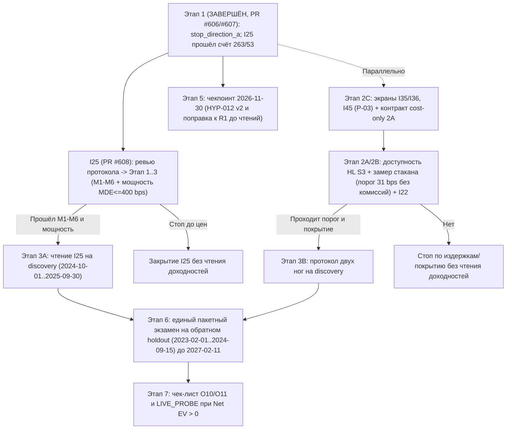

# Пошаговый план действий по итогам консилиума (Draft v3)

Дата: 2026-11-17. Обновление под фактическое состояние `origin/main` и ревью A/C.
Read at: `d5327b1` (`origin/main`), PR #606 (`da22081`), PR #607 (`e3f323d`), PR #608 (`45084ad`), PR #609 (`d5327b1`).

История правок:

- `Draft v1` (`a5fb68f`, B): первичная сборка пошагового плана.
- Правка A (`7ba0e29`, [`positions/a-plan-review-2026-11-15.md`](positions/a-plan-review-2026-11-15.md)):
  исправлено окно экзамена на обратный `holdout` (`2023-02-01..2024-09-15`, так как
  `2025-10-01..2026-09-28` — тестовый год `HYP-031`, отбрасываемый контрактом PR #600)
  и уточнены пороги корзин (`bases >= 20 / 15`, `weeks >= 8`).
- `Draft v2` (`99dbdee`, B): внесены замечания A и C (`P1`/`P2` по границам окон,
  датам архива Hyperliquid, правилу расходования единого `holdout`, разделению чекпоинта
  `2026-11-30` и экзамена, статусу капитала и параллельной подготовке бумажных расчётов);
  финальные уточнения C и Шаг 0 в PR #600 (`6ccd0db`).
- `Draft v3` (`2026-11-17`): синхронизация с итогами PR #606 (`stop_direction_a`; `I25`
  прошёл счётный порог `263/53`), PR #607 (диагностика `A2`), черновиком протокола `I25`
  в PR #608 (`45084ad`), PR #609 (`I43`/`I44`), фиксацией рабочего капитала `USD 5,000`
  владельцем, переносом `I45` (`P-03`) и явным стоп-правилом `2027-02-11`.

Статус: **обновлённый рабочий план (Draft v3) на ревью участников и владельца.** Документ
не читает рыночные данные, не меняет замороженные контракты в одностороннем порядке и не
является разрешением на мерж, запуск `fetch`, выгрузку S3, деплой или живые сделки без
отдельной явной команды владельца на каждый шаг.

---

## 1. Экономическая рамка и рабочие допущения

1. **Рабочий капитал и площадки (`R4`, `R5`, `O9`):**
   - Владелец подтвердил готовность распределять средства между площадками (**Bybit**,
     **Hyperliquid**, при необходимости до 10 площадок) и **2026-11-17 зафиксировал
     рабочий расчётный капитал `USD 5,000`** (допустимая просадка для живого этапа
     фиксируется отдельно до Этапа 7).
   - На этапе лабораторной проверки размер позиции задаёт сетку проверки глубины стакана
     (`VWAP` на **`USD 50 / 250 / 500 / 1,000`**) и минимальный запас обеспечения для
     двухногих сделок; для `I25` в протоколе PR #608 стартовая статическая выполнимость
     проверяется на слоте `USD 50`.
2. **Базовый порог сравнения (`Hurdle Rate`):**
   - Ориентир владельца для свободного USDT — **`5%` годовых** (`USD 250` в год на
     рабочем капитале `USD 5,000`, см.
     [bybit-carry-economics-screen-v1.md](../research/bybit-carry-economics-screen-v1.md)).
     Это **не** безрисковая ставка: размещение USDT на бирже или в стейкинге несёт риск
     площадки/инструмента.
   - Любая торговая стратегия оценивается по **чистому результату (`Net PnL`) на весь
     выделенный капитал** (обе площадки, залог, буфер обеспечения и простой между
     сделками) после всех комиссий, спреда/impact по стакану, фандинга и затрат на
     ребалансировку. Недельные `bps` отдельной сделки напрямую с годовым процентом не
     сравниваются.
3. **Общее стоп-правило программы и цель до `2027-02-11` (`program-plan-2026-11.md`):**
   - Действует зафиксированное стоп-правило из
     [program-plan-2026-11.md](../research/program-plan-2026-11.md#L19): если к
     **`2027-02-11`** ни один кандидат не прошёл нетронутое окно, программа переходит в
     режим сопровождения (`maintenance`) до мартовского обзора.
   - У проекта два параллельных трека:
     1. **Торговый трек:** до `2027-02-11` вывести хотя бы один воспроизводимый механизм
        в экзамен на обратном `holdout` (`2023-02-01..2024-09-15`) с нижней границей
        `Net EV > 0`, измеренный с учётом стакана и превышающий `5%` годовых на весь
        выделенный капитал.
     2. **Низкозатратный нерыночный трек:** без раздувания кода (а) вести при желании
        владельца до-исходный дневник ручных решений по **Radar** (`I12`) и (б) при
        пересмотре владельцем `ADR-0002` (`R8`) — одностраничную оценку платной
        продуктовой задачи на базе Schurfer (`BIZ1`).

---

## 2. Итоговая воронка идей (`I1–I45` и `BIZ1`)

| Категория                                                           | Идеи                                                                                                                                                                                                                                                                                                             | Статус бюджета в текущем цикле                                                                                                                                                                                          |
| ------------------------------------------------------------------- | ---------------------------------------------------------------------------------------------------------------------------------------------------------------------------------------------------------------------------------------------------------------------------------------------------------------- | ----------------------------------------------------------------------------------------------------------------------------------------------------------------------------------------------------------------------- |
| **Завершённые / провалившие проверки (`read_fail` / `paper_fail`)** | `I4` (pump short OI), `I5` (majors short), `I7`/`I19` (Bybit spot-perp carry до `40 bps/день`), `I8` (`HYP-012b/c`), `I9` (`HYP-036`: `-42.80 bps` net), `I10` (`Track B`), `I21` (только комиссия HL), `I41` (grid/DCA), **направление A катализаторы (`I1`, `I2`, `I16`, `I17` — PR #606 `stop_direction_a`)** | **Бюджет закрыт.** `A1`/`A3` (`insufficient_events`), `A4f`/`A4r` (`not_reconstructible`); `A2`/`A4d` (`lab_only`, PR #607) владелец `2026-11-17` решил не продолжать в этом цикле (`parked`).                          |
| **Вне текущего приоритета (`parked` / `untestable`)**               | `I1`, `I2`, `I16`, `I17` (после `stop_direction_a`), `I3`, `I6`, `I23`, `I24`, `I29`, `I34`, `I37`, `I42`; **`I43` Механизм 2** (продолжение спот-потока, `parked` как бюджетное решение); **`I44`** (`CryptoAttack` / `CEXTrack`, `parked` владельцем `2026-11-17`)                                             | Бюджет не выделяется. По `I44`: неполный поток без платной подписки + внешняя задержка + аналогичные CEX-всплески уже проверялись внутри Schurfer (`HYP-016`, `HYP-030`), правило по внешним каналам остаётся закрытым. |
| **Очередь 1: События и жизненный цикл (Этап 3A — PR #608)**         | **`I25`** (шорт дрейфа новых линейных USDT-перпов: `263` запуска / `53` нед. в `discovery`, `254` / `74` в `holdout`)                                                                                                                                                                                            | **Приоритет №1.** Сначала ревью/мерж протокола PR #608 и этапы проверки данных/мощности (`M1–M6` + `MDE <= 400 bps`), и **только затем** чтение доходностей на `discovery`. Счётный порог `263` не доказывает прибыль.  |
| **Очередь 2: Замер стоимости стакана и покрытия (Этап 2A/2B)**      | **`I14 / I15`** (две ноги Bybit – Hyperliquid) и **`I22`** (новый перп HL против живого Bybit)                                                                                                                                                                                                                   | **Приоритет №2 (параллельно).** Отдельный `cost-only` контракт и проверка доступности архивов HL S3 с лимитом затрат до любой выгрузки. `31 bps` — фильтр некомиссионных издержек, не прогноз прибыли.                  |
| **Очередь 3: Бумажные расчёты и малые экраны (Этап 2C)**            | **`I36`** (кросс-секционный кэрри фандинга), **`I35`** (ETH staking + хедж), **`I26/I27`** (базис BTC/ETH, USDT/USDC), **`I38`** (prediction markets), **`I43` Механизм 1** (`needs_measurement`, замер на срезе данных 1–2 нед. после `I25` и `2A`), **`I45`** (внутридневной BTC/ETH, `unscreened`)            | Бумажные экраны без выгрузок. Для `I43` уточняется: «1–2 недели» — это длина среза данных (~1 день скриптовой работы), по возможности на уже выгружаемых для `2A` данных, не в ущерб `I25`/`2A`.                        |
| **Отдельные нерыночные треки и эксплуатация**                       | **`I12`** (личный дневник Radar), **`BIZ1`** (`R8` / `ADR-0002`), **`O11`** (эксплуатационный чек прода)                                                                                                                                                                                                         | `O11` выполнен read-only `2026-11-17` (см. `state.md` §15); закрытие ложных ошибок `cold-bar-export` и проверка `offsite-backup-health` — отдельная эксплуатационная задача.                                            |

---

## 3. Пошаговый план выполнения

### Этап 1. Счёт катализаторов и запусков новых перпов — **ВЫПОЛНЕН (PR #606, #607)**

1. **`PR #606` (`da22081`, 2026-11-16):** `stop_direction_a` (ни одна корзина катализаторов не стала `feasible`: `A1`/`A3` `insufficient_events` при недоступном Upbit, `A4f`/`A4r` `not_reconstructible`, `A2`/`A4d` `lab_only`).
2. **`PR #607` (`e3f323d`, 2026-11-16):** диагностика `A2` подтвердила ограничение правила выделения базы на синтетике и отнесла все `134` holdout-заголовка без базы к `other`; `A2` осталась `lab_only`. Владелец `2026-11-17` закрыл дальнейшее развитие `A2`/`A4d` в этом цикле (`parked`) в пользу `I25` и `Stage 2A`.
3. **`I25` (`instrument_launches`):** `263` запуска / `53` недели в `discovery`, `254` / `74` в `holdout` — порог счёта `>= 100 / >= 20` пройден; это основание перейти к проверке восстановимости данных (не доказательство прибыли или мощности).

---

### Этап 2. Подготовка и бездоходные проверки покрытия/стоимости (0 чтений доходностей)

Документы Этапа 2C и проект контракта Этапа 2A ведутся **параллельно** с ревью протокола `I25`:

1. **Шаг 2A — Доступность архивов HL S3 и замер издержек стакана (`I14/I15`, остаток `I21`):**
   - **Сначала проверка доступности и потолка затрат:** до сетевой выгрузки из платного S3 (`requester-pays`) проверяем наличие и полноту нужных файлов L2 Hyperliquid и фиксируем контракт с потолком объёма/бюджета и отдельным разрешением владельца.
   - **Окно замера:** базовое окно в согласованном `Draft v2` — `discovery` (`2024-10-01..2025-09-30`, без касания `2023-02-01..2024-09-15` и `2025-10-01..2026-09-28`). Если покрытие архивов HL в `discovery` окажется недостаточным, допустимость расширения `cost-only` замера без доходностей на другие даты строго до `2026-09-29` выносится на отдельное согласование `A`/`B`/`C` до чтения.
   - **Что считается и смысл порога `31 bps`:** двусторонний исполняемый `VWAP` (`USD 50 / 250 / 500 / 1,000`). 4 тейкер-сделки стоят `20 bps` базовых комиссий (`2 × 5.5 + 2 × 4.5 bps`); **`x_bybit + x_hl <= 31 bps`** — это добровольный бюджетный фильтр **некомиссионных** издержек полного оборота (комиссии учитываются отдельно). Его прохождение означает лишь, что «исполнение пока не исключает исследование», а не что фандинг покроет сделку. При превышении порога — стоп (`execution_infeasible`) без чтения доходностей.
2. **Шаг 2B — Проверка парных листингов и идентичности для `I22` (Hyperliquid против Bybit):**
   - `first_observed_archive_date` в S3 не приравнивается к `launchTime`: требуется независимое подтверждение момента старта торгов HL и идентичности активов/множителей с `bybit_instruments`. При недостатке подтверждённых пар (`< 40`) — `insufficient_events`.
3. **Шаг 2C — Бумажные отсевы и хвост очереди (`I35`, `I36`, `I45`, `I43`):**
   - Сохраняем в очереди одностраничные бумажные расчёты **`I36`** и **`I35`** (`screens/b-2026-11-15.md` уже содержит их старт, при необходимости уточнения под `USD 5,000`), **`I26`/`I27`**, **`I38`**, а также 1-часовой бумажный экран для перенесённого **`I45`** (внутридневной BTC/ETH).
   - Для **`I43`** (Механизм 1, `needs_measurement`): остаётся в очереди после `I25` и `2A`; его проверка «1–2 недели» означает длину среза данных (~1 день скриптовой работы), и по возможности опирается на данные, уже выгружаемые в рамках замера издержек.

---

### Этап 3. `I25` (PR #608) и лабораторные протоколы на `discovery` (`2024-10-01..2025-09-30`)

1. **`I25` — строгий порядок из [`new-perp-short-lab-protocol-v1.md`](../research/new-perp-short-lab-protocol-v1.md) (PR #608, ревизия 5 на `45084ad`):**
   - **Шаг 3.1 — Завершить ревью и влить PR #608.**
   - **Шаг 3.2 — Этап 1 (`M1–M6` на `discovery`, 0 чтений доходностей):** проверить на `discovery` реальный смысл `launchTime` против первых сделок, полноту каталога против торговых архивов, наличие спот-истории, непрерывность истории фандинга, наличие 1m trade/mark-баров, статическую выполнимость слота `USD 50` и идентичность каждого запуска.
   - **Шаг 3.3 — Этап 1b (holdout coverage-only) и Этап 2–3 (мощность `MDE <= 400 bps` и регистрация контракта).** Большинство стоп-кодов (`not_reconstructible`, `incomplete_coverage`, `capital_infeasible`, `insufficient_power`) срабатывают **до** чтения цен/доходностей.
   - **Шаг 3.4 — Этап 4 (чтение стратегии на `discovery`, только после прохождения 3.2–3.3):**
     - комиссия считается от стоимости каждого фактического исполнения (`phi * q * F_e + phi * q * F_x`, а не фиксированными «22 bps от входа»; саму ставку и применимость Innovation Zone нужно обосновать по данным/правилам биржи);
     - правило риска (`+30%` стоп, `2x` маржа) проверяется по сценариям гэпов и ликвидации `T_liq` на 1-минутных свечах — оно **не гарантирует потолок убытка** и не заменяет реальный `VWAP`;
     - оценка net-доходности ведётся **на весь зарезервированный капитал `USD 5,000`** с учётом фактического фандинга, `beta`-поправки, кластеризации по неделям запуска и порога `5%` годовых (`USD 250/год`).
2. **Кандидат класса «Две ноги / Кэрри» (`I14/I15`, `I22`, `I36` — Этап 3B, только после прохождения Этапа 2):**
   - 4 исполнения по `VWAP`, фактический почасовой vs 8/4/2/1-часовой фандинг, риск неисполнения второй ноги и доходность на весь капитал `USD 5,000`.
3. **Общие правила анализа на `discovery`:**
   - обязательное разложение `PnL` (`beta + сигнал + фандинг - издержки`) и портфельный учёт;
   - продолжение учёта 124+ уже просмотренных вариантов на `discovery`;
   - явные коды остановки без подгонки параметров под результат.

---

### Этап 4. Нерыночные треки (`I12`, `BIZ1`) и внешние уведомления (`I44`)

1. **Дневник ручных решений Radar (`I12`):** владелец может вести журнал решений до исхода; сопоставление с рыночными исходами после `2026-09-29` не проводится до закрытия `HYP-012 v2` или формальной поправки к `R1`.
2. **Одностраничная оценка `BIZ1` (`R8` / `ADR-0002`):** активируется как запасной/параллельный план при пересмотре `ADR-0002` владельцем (особенно с учётом дедлайна `2027-02-11`).
3. **Внешний поток уведомлений `I44` (`CryptoAttack` / `CEXTrack`):** `2026-11-17` переведён в `parked` владельцем — правило `external Telegram channels are reference-only` не пересматривается (неполный поток без премиум-подписки, дополнительная задержка доставки и уже проверенные аналогичные CEX-всплески в `HYP-016` / `HYP-030`).

---

### Этап 5. Плановый чекпоинт `2026-11-30`

1. Проверить статус накопления когорты `HYP-012 v2` на `2026-11-30 00:00 UTC`.
2. Обсудить вопрос формальной поправки к `R1` (слепое окно с `2026-09-29`). Поправку можно обсуждать заранее, но любые изменения правил должны быть **зафиксированы документально до соответствующих чтений**.

---

### Этап 6. Единый пакетный экзамен на обратном `holdout` (`2023-02-01..2024-09-15`) до `2027-02-11`

- Обратный `holdout` (`2023-02-01..2024-09-15`) расходуется **один раз** единым заранее зафиксированным пакетом (или одним выжившим кандидатом) после завершения Этапа 3 и Этапа 2 — никогда по одному кандидату за раз.
- Если к **`2027-02-11`** ни один кандидат не прошёл нетронутое окно, действует стоп-правило программы (`maintenance` до марта).

---

### Этап 7. Безопасность перед живым выходом (`O10`, `O11`) и `LIVE_PROBE`

- При `Net EV > 0` на `holdout` и прохождении порога `5%` годовых на весь капитал `USD 5,000`: фиксация лимита допустимой просадки владельцем, прохождение чек-листа `O10` (рестарт, `clientOrderId`, частичное исполнение/вторая нога, `stale quotes`, учёт, `kill switch`) и повторная актуальная сверка `O11` (с разбором текущих ошибок таймеров `schurfer-cold-bar-export` и `schurfer-offsite-backup-health`, зафиксированных в `state.md` §15).

---

## 4. Ближайшие конкретные действия (актуально на `2026-11-17`)

1. **Владелец (`mavlevich`) и участники:** согласовать текст PR #610 (и при желании удалить устаревший черновик `docs/consilium/` с локальной ветки `docs/improvement-roadmap-v3` после переноса `I45`/`P-03`).
2. **По `I25` (PR #608):** завершить ревью/мерж протокола на `45084ad` и отдельным разрешением владельца запустить Этап 1 проверки данных (`M1–M6` на `discovery`).
3. **Параллельно по `Stage 2A` и `Stage 2C`:** проверить доступность/стоимость S3-архивов Hyperliquid, подготовить проект короткого `cost-only` контракта, не терять бумажные расчёты `I35`/`I36` и `I45`.
4. **Эксплуатация (`O11` follow-up):** проверить под `sudo` причину ненулевого выхода `schurfer-offsite-backup-health.service` и при необходимости отключить/адаптировать таймер `schurfer-cold-bar-export.timer` под остановленную Group 1.
