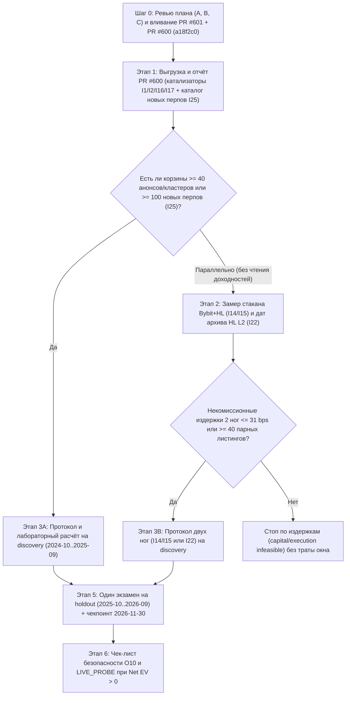

# Пошаговый план действий по итогам консилиума (Draft v1)

Дата: 2026-11-15. Автор черновика: B (на основе согласованных позиций A, B, C и ответов владельца).
Read at: `27551c6` (`origin/main`), консилиум `e734ad9`, PR #600 `a18f2c0`.

Статус: **черновик пошагового плана для ревью участниками A и C и утверждения владельцем.**
Этот документ не читает рыночные данные, не меняет замороженные контракты в одностороннем
порядке и не является разрешением на запуск `fetch`, деплой или живые сделки без явной
команды владельца на каждый шаг.

---

## 1. Экономическая рамка и критерии успеха

1. **Рабочий капитал и площадки (`R4`, `R5`):**
   - Доступный рабочий капитал для проверенной стратегии: **`USD 3,000–5,000`** с возможностью
     распределения между площадками (**Bybit**, **Hyperliquid**, при необходимости до 10 площадок).
   - На этапе лабораторной проверки размер позиции не меняет знак отрицательного ожидания на одной ноге,
     но определяет минимально допустимую глубину стакана (`VWAP` на **`USD 50 / 250 / 500 / 1,000`**)
     и минимальный запас маржи для двухногих сделок.
2. **Базовый порог доходности (`Hurdle Rate`):**
   - Альтернатива без торгового риска — **`5%` годовых на свободный USDT** (`~USD 150–250` в год
     на `USD 3,000–5,000`, см. [bybit-carry-economics-screen-v1.md](../research/bybit-carry-economics-screen-v1.md)).
   - Любая торговая стратегия оценивается по **чистому результату (`Net PnL`) на весь выделенный капитал**
     (включая буферы обеспечения на обеих площадках и простой между сделками) после всех комиссий,
     спреда/impact по стакану, фандинга и затрат на ребалансировку, и должна перекрывать `5%` годовых с запасом.
3. **Масштаб денег и цель до марта 2027 (`O9`):**
   - На капитале `USD 5,000` доходность `10–20%` годовых даёт `USD 42–83` в месяц — это **доказательство
     работоспособности и масштабируемости**, а не конечный целевой доход.
   - Поэтому у проекта две параллельные задачи:
     1. **Торговый трек:** найти до марта 2027 хотя бы один воспроизводимый механизм с нижней границей
        `Net EV > 0` на чистом окне (`holdout`), измеренный по реальному стакану на размерах до `USD 1,000+`
        на сделку, чтобы после доказательства капитал можно было масштабировать.
     2. **Нерыночный/низкозатратный трек:** параллельно и без раздувания кода проверить (а) добавляет ли
        ручной отбор владельца поверх **Radar** (`I12`) положительное ожидание и (б) при ревизии `ADR-0002` (`R8`)
        оценить на одной странице платную продуктовую задачу на базе инфраструктуры Schurfer (`BIZ1`).

---

## 2. Итоговая воронка идей (что закрыто, что в работе, что в очереди)

Из 42 торговых идей (`I1–I42`) и `BIZ1` в [`ideas.md`](ideas.md) консилиум отсеял заведомо тупиковые ветки:

| Категория                                                                           | Идеи                                                                                                                                                                                                                                                                                                                                                                      | Решение консилиума                                                                                                                            |
| ----------------------------------------------------------------------------------- | ------------------------------------------------------------------------------------------------------------------------------------------------------------------------------------------------------------------------------------------------------------------------------------------------------------------------------------------------------------------------- | --------------------------------------------------------------------------------------------------------------------------------------------- |
| **Закрыты окончательно (`read_fail` / `paper_fail`)**                               | `I4` (pump short OI), `I5` (majors short horizon), `I7`/`I19` (Bybit spot-perp carry до `40 bps/день`), `I8` (cross-venue lead `HYP-012b/c`), `I9` (`HYP-036` absorbed buying: `-42.80 bps` net, `-12.80 bps` gross), `I10` (`Track B` funding settlement), `I21` (перенос на Hyperliquid только ради разницы комиссий `4.5` vs `5.5 bps`), `I41` (grid/DCA/copy-trading) | **Бюджет 0.** Короткие минутные паттерны на свечах и потоке ордеров альт-перпов больше не исследуются.                                        |
| **Заморожены / вне контура (`parked` / `untestable`)**                              | `I3` (token unlocks без первичного источника), `I6` (BTC trend без edge-claim), `I23` (ликвидации HL без архива позиций), `I24` (weekend alts), `I29` (airdrop farming), `I34` (традиционные ETF/фьючерсы вне крипты), `I37` (пассивный депозит в чужой HLP vault), `I42` (on-chain MEV/liquidation race)                                                                 | Не тратить исследовательский бюджет платформы.                                                                                                |
| **Приоритет 1: Счёт событий (Этап 1 — PR #600)**                                    | **`I1`, `I2`, `I16`, `I17`** (катализаторы: листинги, делистинги, monitoring tag, смена интервала фандинга и риск-лимитов) + **`I25`** (шорт дрейфа новых перпов через несколько дней после листинга) + половина **`I22`** (каталог дат старта Bybit)                                                                                                                     | **Запускается первым** после вливания PR #600 (`a18f2c0`). Один `fetch` даёт точные числа событий сразу для катализаторов и для `I25`.        |
| **Приоритет 2: Замер стоимости стакана и покрытия без чтения доходностей (Этап 2)** | **`I14 / I15`** (две ноги Bybit – Hyperliquid вокруг расчёта фандинга и базиса) и **`I22`** (новый перп на Hyperliquid против живого перпа на Bybit)                                                                                                                                                                                                                      | Требуют короткого контракта **только на издержки/покрытие** (архивы стаканов L2 Bybit и Hyperliquid до `2026-09-29`, без чтения доходностей). |
| **Приоритет 3: Короткий бумажный отсев второго эшелона (Этап 2C)**                  | **`I36`** (кросс-секционный кэрри фандинга между перпами), **`I35`** (ETH staking + хедж перпом против порога `5%` USDT), **`I26/I27`** (квартальный базис BTC/ETH и спред USDT/USDC перпов), **`I38`** (рынки предсказаний)                                                                                                                                              | Одностраничные формульные проверки перед любым написанием кода.                                                                               |
| **Параллельный трек без разработки (Этап 4)**                                       | **`I12`** (журнал ручных решений владельца поверх Radar до исхода) и **`BIZ1`** (проверка одной платной проблемы на базе Schurfer при снятии `R8`)                                                                                                                                                                                                                        | Не требуют выгрузок рыночных данных и не конкурируют за бюджет бэктестов.                                                                     |

---

## 3. Пошаговый план выполнения

### Шаг 0. Финализация ревью и мерж PR #601 и PR #600

1. **Проверка PR #600 (`a18f2c0`):**
   - `B` проверил коммит `a18f2c0` (55 тестов `pytest`, `ruff check`, `mypy --strict` пройдены; блокеры `C-F4`, `C-F5`, `C-F6` закрыты) — вердикт `B`: **`APPROVE`**.
   - `C` подтверждает закрытие `C-F4`, `C-F5`, `C-F6` на ревизии `a18f2c0` (при необходимости уточняет открытый вопрос о проверке покрытия из секции 5 контракта).
2. **Действие владельца:**
   - Влить PR #601 (`docs/consilium-positions-2026-11-15`) в `main`.
   - Влить PR #600 (`docs/catalyst-feasibility-v1`, `a18f2c0`) в `main`.

---

### Этап 1. Запуск счёта катализаторов и каталога новых перпов (0 чтений цен)

1. **Команда (только после явного разрешения владельца на `fetch`):**
   - Запустить `catalyst_feasibility.py fetch` и `catalyst_feasibility.py report` из чистого `main`.
2. **Два результата из одной выгрузки:**
   - **Результат 1A (Катализаторы `I1`, `I2`, `I16`, `I17`):** официальный отчёт `report` по корзинам `A1`, `A2`, `A3`, `A4d`, `A4f`, `A4r` в окне `discovery` (`2024-10..2025-09`) и запечатанном `holdout` (`2025-10..2026-09`).
   - **Результат 1B (Новые перпы `I25` и половина `I22`):** из уже сохранённых квитанций `bybit_instruments` (без единого нового сетевого запроса) посчитать число новых линейных USDT-перпов (включая закрытые контракты) и число уникальных ISO-недель запусков в `discovery`.
3. **Условия остановки и перехода:**
   - Корзина катализаторов проходит дальше только при `clusters >= 40` (`30` в holdout), `announcements >= 40` (`30` в holdout), `weeks >= 8` (`6` в holdout) и `discordant_share <= 5%` внутри своего каталога.
   - `I25` (шорт дрейфа новых перпов) проходит к написанию протокола, если в `discovery` есть **не менее 100 запусков и не менее 20 недель с запусками** (см. [`screens/a-2026-11-15.md`](screens/a-2026-11-15.md)).

---

### Этап 2. Замер стоимости стакана двух площадок и покрытия (0 чтений доходностей)

Выполняется по очереди `C`, чтобы отсеять неисполнимые идеи до чтения цен:

1. **Шаг 2A — Замер реальных издержек стакана Bybit и Hyperliquid (`I14 / I15` и остаток `I21`):**
   - Оформить короткий контракт **только на издержки (`cost-only`)** на датах до `2026-09-29`:
     посчитать двусторонний исполняемый `VWAP` (покупка по `asks`, продажа по `bids`) на размерах
     **`USD 50 / 250 / 500 / 1,000`** по архиву стакана Bybit и архиву L2 Hyperliquid для общих монет.
   - **Условие остановки:** 4 тейкер-сделки стоят `20 bps` чистой комиссии (`2 × 5.5 + 2 × 4.5 bps`).
     Если сумма некомиссионных издержек круга (`x_bybit + x_hl`) на монетах с разрывом фандинга превышает
     **`31 bps`** (общий барьер `> 51 bps`), семейство `I14/I15` в тейкер-варианте останавливается
     со статусом `execution_infeasible` без чтения доходностей.
2. **Шаг 2B — Проверка числа парных запусков для `I22` (Hyperliquid против Bybit):**
   - По списку путей архива L2 Hyperliquid (только даты первых файлов по монете, без чтения цен) и
     каталогу `bybit_instruments` из Этапа 1 проверить, сколько монет запустились на Hyperliquid, когда
     на Bybit уже минимум 24 часа торговался перп на тот же базовый актив.
   - **Условие остановки:** если меньше `40` таких запусков — стоп (`insufficient_events`).
3. **Шаг 2C — Одностраничный бумажный отсев `I36` и `I35` + роль редких бирж:**
   - Написать 1 страницу расчёта для **`I36`** (кросс-секционный кэрри по фандингу между перпами) и
     1 страницу формулы для **`I35`** (ETH staking + хедж перпом против `5%` годовых на USDT).
   - Для редких бирж (**Gate.io, MEXC, Bitget**): закрепить роль **источника сигнала/события** (где не нужен
     капитал на площадке); как место исполнения рассматривать только в том случае, если Этап 2A покажет
     недостаточность связки Bybit + Hyperliquid.

---

### Этап 3. Лабораторный протокол на окне `discovery` (`2024-10..2025-09`)

Из кандидатов, прошедших Этапы 1 и 2, открывается **не более одного протокола за раз в каждом классе**:

1. **Кандидат класса «События / Жизненный цикл» (выжившие корзины катализаторов `I1/I2/I16/I17` или `I25` шорт новых перпов):**
   - Для катализаторов: замер глубины стакана и `VWAP` в секунду реалистичного входа (с учётом задержки доставки),
     один заранее зафиксированный горизонт на корзину (плюс не более одного длинного варианта для `A3`/`A4d`).
   - Для **`I25` (шорт дрейфа новых перпов через $k$ дней после листинга):**
     - полная когорта всех запусков в окне `discovery` (включая делистнутые перпы);
     - учёт повышенной комиссии **Innovation Zone (`22 bps` на круг)** + реального спреда по стакану;
     - точный расчёт накопленного фандинга за время удержания;
     - очистка от общерыночного движения (`beta-adjusted return`) и кластеризация по неделям запуска;
     - обязательное правило ограничения риска правого хвоста (`short squeeze`: изолированная маржа / стоп / потолок потерь на сделку).
2. **Кандидат класса «Две ноги / Кэрри» (`I14/I15`, `I22` или `I36`, если прошли Этап 2):**
   - Полный портфельный расчёт: 4 исполнения по `VWAP` стакана, фандинг обеих ног по фактическому расписанию
     (1 час у Hyperliquid против 8/4/2/1 часов у Bybit), риск неисполнения второй ноги и доходность на **весь**
     зарезервированный капитал (включая буферы обеспечения на обеих площадках).
3. **Правила анализа внутри Этапа 3 (согласовано A, B, C):**
   - Обязательное разложение `PnL` на 4 слагаемых: `рынок (beta)` + `сигнал отбора` + `фандинг` − `издержки исполнения`.
   - На раскрытом окне `discovery` допускается ограниченная исследовательская песочница (включая отбор признаков / ML)
     при условии полной записи числа попыток, сравнения с простым базовым правилом и запрета на донастройку в `holdout`.
   - Запрещено переименовывать отрицательный результат в «нехватку разнообразия» — каждый отказ получает точный код
     (`not_reconstructible`, `incomplete_coverage`, `insufficient_events`, `move_gone_before_entry`,
     `execution_infeasible`, `negative_net_after_costs`).

---

### Этап 4. Параллельные низкозатратные треки (0 чтений закрытых окон)

1. **Журнал ручных решений владельца по сигналам Radar (`I12`):**
   - При появлении сигнала в Radar владелец (по желанию) фиксирует **до исхода**: время, инструмент,
     решение (`взять / пропустить`), причину в одной строке и предполагаемый стоп/размер.
   - Никакой код для этого писать не нужно; накопленный журнал позволит честно проверить на разрешённом окне,
     бьёт ли ручной фильтр базовую выборку радара.
2. **Одностраничная проверка `BIZ1` (только если владелец решит пересмотреть `ADR-0002` / `R8`):**
   - Описать на 1 странице одну конкретную платную задачу (например: мониторинг изменений правил/листингов
     бирж или сверка стоимости исполнения) и способ проверить наличие хотя бы 1–3 платящих пользователей
     до написания любого нового UI/SaaS-кода.

---

### Этап 5. Экзамен на чистом окне (`holdout`) и чекпоинт 2026-11-30

1. **Экзамен (`2025-10..2026-09`):**
   - Кандидат, давший в Этапе 3 положительный чистый результат (`Net EV > 0` после всех издержек стакана и
     выше барьера `5%` годовых на капитал), проходит **один фиксированный экзамен** на нетронутом окне `holdout`
     без изменения параметров.
2. **Плановый чекпоинт 2026-11-30:**
   - Собрать результаты Этапов 1–3.
   - Рассмотреть вопрос по правилу **`R1` (слепое окно `HYP-012 v2` с `2026-09-29`)**:
     - не нарушать правило задним числом;
     - при необходимости оформить формальную поправку (`amendment`), которая либо сужает запрет `HYP-012 v2`
       до используемых в `v2` инструментов и площадок, либо явно разрешает замеры технических издержек без
       доходностей (задержка доставки анонсов `A0`, текущая глубина стакана на новых площадках).

---

### Этап 6. Предпусковая проверка безопасности (`O10`) и `LIVE_PROBE`

Если кандидат прошёл экзамен Этапа 5 с нижней границей `Net EV > 0` на целевом размере:

1. Назначить ответственного за проверку живого маршрута (`O10`).
2. Проверить до первой живой сделки:
   - сверку неизвестных/открытых позиций при рестарте контейнера;
   - детерминированный `clientOrderId` и защиту от дублей;
   - обработку частичного исполнения и отказа второй ноги / стоп-ордера;
   - защиту от устаревших котировок (`stale quotes`);
   - жёсткие лимиты потерь на эпизод и на сутки + `kill switch`;
   - актуальное состояние диска, таймеров и бэкапов на продакшене (`O11`).
3. Только после прохождения этого списка владелец выдаёт отдельное разрешение на перевод `LIVE_PROBE`
   из состояния `idle` в активную пробу с фиксированным бюджетом риска.

---

## 4. Что требуется сейчас от участников консилиума и владельца

1. **Участники `A` и `C`:**
   - Проверить этот план (`docs/consilium/plan.md`) и подтвердить:
     - согласны ли с порядком **Этап 1 (PR #600: катализаторы + счёт новых перпов `I25`) → Этап 2 (замер стакана `I14/I15` + покрытие `I22` + бумаги `I36/I35`) → Этап 3 (лаборатория на `discovery`) → Этап 5 (экзамен + чекпоинт 2026-11-30)**;
     - подтверждает ли `C`, что коммит `a18f2c0` в PR #600 закрывает находки `C-F4`, `C-F5`, `C-F6`.
2. **Владелец (`mavlevich`):**
   - После подтверждения от `A` и `C` дать команду на вливание PR #601 и PR #600 и отдельную команду на запуск
     первой выгрузки (`catalyst_feasibility.py fetch` и `report`).
