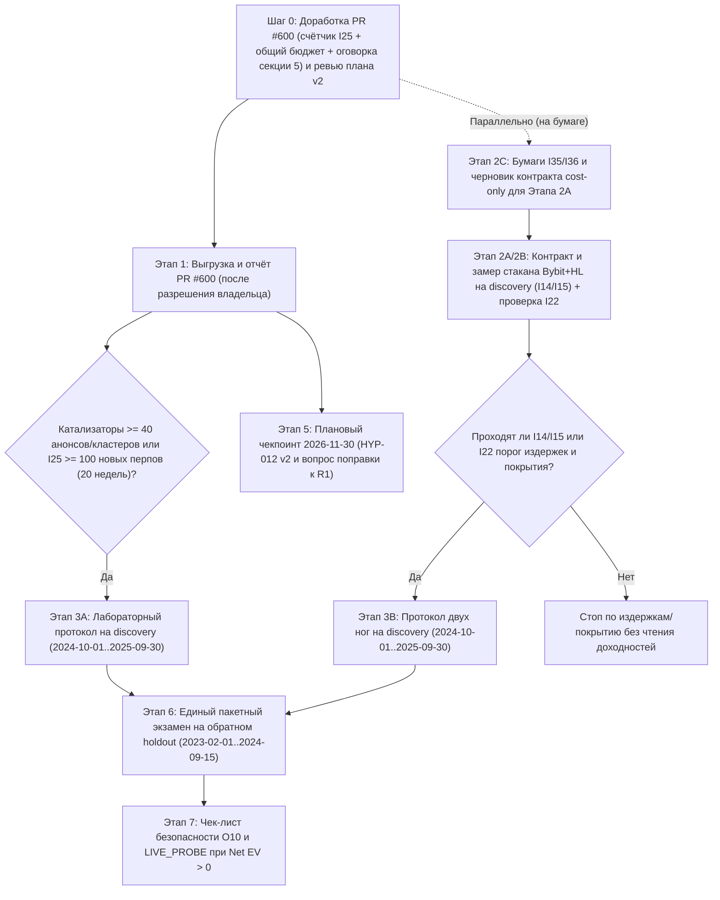

# Пошаговый план действий по итогам консилиума (Draft v2)

Дата: 2026-11-15. Автор черновика: B (с учётом ревью A в `7ba0e29` и ревью C).
Read at: `27551c6` (`origin/main`), консилиум `99dbdee`, PR #600 `6ccd0db`.

История правок:

- `Draft v1` (`a5fb68f`, B): первичная сборка пошагового плана.
- Правка A (`7ba0e29`, [`positions/a-plan-review-2026-11-15.md`](positions/a-plan-review-2026-11-15.md)):
  исправлено окно экзамена на обратный `holdout` (`2023-02-01..2024-09-15`, так как
  `2025-10-01..2026-09-28` — тестовый год `HYP-031`, отбрасываемый контрактом PR #600)
  и уточнены пороги корзин (`bases >= 20 / 15`, `weeks >= 8`).
- `Draft v2` (`99dbdee`, B): внесены замечания A и C (`P1`/`P2` по границам окон,
  датам архива Hyperliquid, правилу расходования единого `holdout`, разделению чекпоинта
  `2026-11-30` и экзамена, статусу капитала и параллельной подготовке бумажных расчётов).
- Финальные уточнения C (B): переход корзин катализаторов дальше привязан к `verdict == "feasible"`
  из официального отчёта `report`, уточнена формулировка иллюстрации доходности на малом капитале,
  а три доработки Шага 0 внесены в PR #600 на коммите `6ccd0db` (57 тестов).

Статус: **черновик пошагового плана (Draft v2) для финального подтверждения A и C и
решения владельца.** Документ не читает рыночные данные, не меняет замороженные контракты
в одностороннем порядке и не является разрешением на мерж, запуск `fetch`, деплой или
живые сделки без отдельной явной команды владельца на каждый шаг.

---

## 1. Экономическая рамка и рабочие допущения

1. **Рабочий капитал и площадки (`R4`, `R5`):**
   - Владелец подтвердил готовность рассматривать разумную инвестицию и распределять средства
     между площадками (**Bybit**, **Hyperliquid**, при необходимости до 10 площадок).
   - Диапазон **`USD 3,000–5,000`** используется в плане как **рабочее расчётное допущение**
     (предложенное A в `O9`), пока владелец не зафиксирует точный лимит капитала и допустимой просадки.
   - На этапе лабораторной проверки размер позиции не меняет знак отрицательного ожидания на одной ноге,
     но задаёт сетку проверки глубины стакана (`VWAP` на **`USD 50 / 250 / 500 / 1,000`**)
     и минимальный запас обеспечения для двухногих сделок.
2. **Базовый порог доходности (`Hurdle Rate`):**
   - Ориентир владельца для свободного USDT без торгового риска — **`5%` годовых**
     (`~USD 150–250` в год при расчётном капитале `USD 3,000–5,000`, см.
     [bybit-carry-economics-screen-v1.md](../research/bybit-carry-economics-screen-v1.md)).
   - Любая торговая стратегия оценивается по **чистому результату (`Net PnL`) на весь выделенный капитал**
     (включая буферы обеспечения на обеих площадках и простой между сделками) после всех комиссий,
     спреда/impact по стакану, фандинга и затрат на ребалансировку, и должна перекрывать `5%` годовых с запасом.
3. **Масштаб денег и цель до марта 2027 (`O9`):**
   - При расчётном капитале `USD 5,000` доходность `10–20%` годовых даёт `USD 42–83` в месяц — это
     **иллюстрация денежного результата** на малом счёте (доказательство положительного ожидания;
     масштабируемость по глубине стакана подтверждается отдельно).
   - Поэтому у проекта две параллельные задачи:
     1. **Торговый трек:** найти до марта 2027 хотя бы один воспроизводимый механизм с нижней границей
        `Net EV > 0` на обратном `holdout` (`2023-02-01..2024-09-15`), измеренный по реальному стакану
        на размерах до `USD 1,000+` на сделку, чтобы после доказательства капитал можно было масштабировать.
     2. **Низкозатратный нерыночный трек:** без раздувания кода подготовить (а) протокол проверки ручного
        отбора владельца поверх **Radar** (`I12`) на разрешённом окне и (б) при пересмотре владельцем
        `ADR-0002` (`R8`) — одностраничную оценку платной продуктовой задачи на базе Schurfer (`BIZ1`).

---

## 2. Итоговая воронка идей (42 идеи `I1–I42` и `BIZ1`)

Новые строки в [`ideas.md`](ideas.md) в этом цикле больше не добавляются — переходим к получению
измеримых ответов:

| Категория                                                                         | Идеи                                                                                                                                                                                                                                                                                                                                                                      | Статус бюджета в текущем цикле                                                                                                                                    |
| --------------------------------------------------------------------------------- | ------------------------------------------------------------------------------------------------------------------------------------------------------------------------------------------------------------------------------------------------------------------------------------------------------------------------------------------------------------------------- | ----------------------------------------------------------------------------------------------------------------------------------------------------------------- |
| **Прочитанные проверки не прошли (`read_fail` / `paper_fail`)**                   | `I4` (pump short OI), `I5` (majors short horizon), `I7`/`I19` (Bybit spot-perp carry до `40 bps/день`), `I8` (cross-venue lead `HYP-012b/c`), `I9` (`HYP-036` absorbed buying: `-42.80 bps` net, `-12.80 bps` gross), `I10` (`Track B` funding settlement), `I21` (перенос на Hyperliquid только ради разницы комиссий `4.5` vs `5.5 bps`), `I41` (grid/DCA/copy-trading) | **Бюджет сейчас не выделяется.** Конкретные проверенные формулировки провалились; возврат возможен только при принципиально новом механизме и отдельном решении.  |
| **Вне текущего приоритета (`parked` / `untestable`)**                             | `I3` (token unlocks без первичного источника), `I6` (BTC trend без edge-claim; вариант снижения просадки относительно BTC/cash возможен только как отдельная цель), `I23` (ликвидации HL без проверенного способа реконструкции позиций), `I24` (weekend alts), `I29` (airdrop farming), `I34` (активы вне крипты), `I37` (чужой HLP vault), `I42` (on-chain MEV)         | Исследовательский бюджет сейчас не выделяется.                                                                                                                    |
| **Очередь 1: Счёт событий (Этап 1 — PR #600)**                                    | **`I1`, `I2`, `I16`, `I17`** (катализаторы: листинги, делистинги, monitoring tag, смена интервала фандинга и риск-лимитов) + **`I25`** (шорт дрейфа новых перпов через несколько дней после листинга) + половина **`I22`** (каталог дат старта Bybit)                                                                                                                     | **Первый шаг исполнения** после небольшого патча и вливания PR #600. Один `fetch` даёт данные сразу для катализаторов и для счёта запусков `I25`.                 |
| **Очередь 2: Замер стоимости стакана и покрытия без чтения доходностей (Этап 2)** | **`I14 / I15`** (две ноги Bybit – Hyperliquid вокруг расчёта фандинга и базиса) и **`I22`** (новый перп на Hyperliquid против живого перпа на Bybit)                                                                                                                                                                                                                      | Требуют отдельного контракта **только на издержки/покрытие** строго внутри окна `discovery` (`2024-10-01..2025-09-30`), без касания `holdout`.                    |
| **Очередь 3: Бумажные расчёты параллельно Этапу 1 (Этап 2C)**                     | **`I36`** (кросс-секционный кэрри фандинга между перпами), **`I35`** (ETH staking + хедж перпом против порога `5%` USDT), **`I26/I27`** (квартальный базис BTC/ETH и спред USDT/USDC перпов), **`I38`** (рынки предсказаний)                                                                                                                                              | Одностраничные формульные расчёты и черновик контракта `cost-only` готовятся параллельно, не дожидаясь окончания выгрузки PR #600.                                |
| **Отдельные нерыночные треки (Этап 4)**                                           | **`I12`** (дневник ручных решений владельца поверх Radar до исхода) и **`BIZ1`** (проверка одной платной задачи на базе Schurfer при пересмотре `R8`)                                                                                                                                                                                                                     | Личный дневник владельца не читает закрытые окна; исследовательская оценка `I12` возможна только на явно разрешённом окне. `BIZ1` — по решению владельца по `R8`. |

---

## 3. Пошаговый план выполнения

### Шаг 0. Точечная доработка PR #600 перед мержем и синхронизация консилиума

1. **Статус проверки PR #600 (`a18f2c0` → `6ccd0db`):**
   - `B` и `C` проверили `a18f2c0`: находки `C-F4`, `C-F5`, `C-F6` закрыты (55 модульных тестов,
     126 пакетных тестов, `ruff`, `mypy --strict` и 3 синтетических граничных теста проходят).
2. **Три небольшие правки в PR #600 до первой выгрузки (согласованы A, B, C и реализованы в `6ccd0db`):**
   - **Правка 0.1 (`I25` счётчик запусков):** добавлен в `catalyst_feasibility.py` (`instrument_launches`)
     и секцию 7 контракта подсчёт числа уникальных новых линейных USDT-перпов, базовых активов и
     ISO-недель запусков по окнам (`discovery` и `holdout`) из дедуплицированного каталога
     `bybit_instruments` (с модульным тестом), чтобы один запуск `report` сразу выдавал ответ для `I25`.
   - **Правка 0.2 (общий бюджет при перезапуске):** добавлен флаг `--prior-root` в `fetch` (`prior_usage`),
     который переносит уже израсходованные запросы и байты остановленного прогона в `run.json` нового `root`,
     вычитает их из общего лимита (`MAX_REQUESTS = 3,000`, `MAX_BYTES = 64 MiB`) и записывает в
     `provenance.prior_runs` (с модульным тестом).
   - **Правка 0.3 (оговорка по секции 5 контракта):** явно зафиксировано в `docs/research/catalyst-feasibility-v1.md`
     (секция 5), что сверка каталога `bybit_instruments` с торговым архивом `public.bybit.com` не выполняется
     внутри этого модуля, поэтому полученное число инструментов отражает покрытие API-каталога Bybit, а не
     гарантированно полный исторический реестр.
3. **Решение о мерже:**
   - Ни PR #601, ни PR #600 не вливаются автоматически: мерж каждого PR выполняется только по отдельной
     команде владельца.

---

### Этап 1. Запуск счёта катализаторов и запусков новых перпов (0 чтений цен)

1. **Команда (только после отдельного разрешения владельца на `fetch` из чистого `main`):**
   - Запустить `catalyst_feasibility.py fetch` и `catalyst_feasibility.py report`.
2. **Два результата из одной выгрузки:**
   - **Результат 1A (Катализаторы `I1`, `I2`, `I16`, `I17`):** официальный отчёт `report` по корзинам
     `A1`, `A2`, `A3`, `A4d`, `A4f`, `A4r` в окне `discovery` (`2024-10-01..2025-09-30`) и запечатанном
     обратном `holdout` (`2023-02-01..2024-09-15`).
   - **Результат 1B (Новые перпы `I25` и половина `I22`):** поле `instrument_launches` в отчёте `report` —
     число новых линейных USDT-перпов (включая закрытые контракты, попавшие в API-каталог Bybit), базовых
     активов и уникальных ISO-недель запусков в окне `discovery`.
3. **Условия остановки и перехода:**
   - Корзина катализаторов проходит дальше только при **`verdict == "feasible"`** в официальном отчёте
     `report` (что проверяет все гейты качества источника — точность секундных меток, долю расхождений
     машинных времён и порядок `id` внутри каждого каталога — а также все минимумы обоих окон:
     `clusters >= 40 / 30`, `announcements >= 40 / 30`, `bases >= 20 / 15`, `weeks >= 8`,
     `timed_share >= 90%`, `ambiguous_share <= 10%`).
   - `I25` (шорт дрейфа новых перпов) проходит к написанию протокола, если в `instrument_launches.discovery`
     есть **не менее 100 запусков и не менее 20 недель с запусками** (см. [`screens/a-2026-11-15.md`](screens/a-2026-11-15.md)).

---

### Этап 2. Бумажная подготовка и ограниченный замер стакана/покрытия (0 чтений доходностей)

Документы Этапа 2C и проект контракта Этапа 2A могут готовиться **параллельно** с Шагом 0 и Этапом 1:

1. **Шаг 2A — Замер реальных издержек стакана Bybit и Hyperliquid (`I14 / I15` и остаток `I21`):**
   - **Контракт и разрешение:** поскольку архив L2 Hyperliquid хранится в платном S3 (`requester-pays`)
     с негарантированной полнотой, до любого сетевого запроса оформляется отдельный короткий контракт
     с потолком объёма скачивания/затрат и получается отдельное разрешение владельца.
   - **Строгая граница окна (`P1` от C):** замер проводится **только внутри окна `discovery`
     (`2024-10-01..2025-09-30`)** на заранее зафиксированной выборке дат и общих монет. Чтение стакана
     на датах обратного `holdout` (`2023-02-01..2024-09-15`) или тестового года `HYP-031`
     (`2025-10-01..2026-09-28`) запрещено, так как снимки стакана содержат цены и режимы ликвидности.
   - **Что считается:** двусторонний исполняемый `VWAP` (покупка по `asks`, продажа по `bids`) на размерах
     **`USD 50 / 250 / 500 / 1,000`** без повторного вычитания спреда.
   - **Рабочий порог отсева (`P2` от C):** 4 тейкер-сделки стоят `20 bps` базовой комиссии (`2 × 5.5 + 2 × 4.5 bps`).
     В качестве **добровольного бюджетного порога** (основанного на постфактум выбранном в старом
     поисковом скрине значении `+51.2 bps`, которое не является доказанным ожиданием) используется граница
     суммарных некомиссионных издержек круга `x_bybit + x_hl <= 31 bps`. Если на монетах с разрывом фандинга
     стакан дороже этого порога, тейкер-вариант `I14/I15` останавливается со статусом `execution_infeasible`
     без чтения доходностей.
2. **Шаг 2B — Проверка идентичности и дат для `I22` (Hyperliquid против Bybit):**
   - **Строгая семантика дат (`P1` от C):** дата первого файла монеты в архиве S3 L2 Hyperliquid — это
     **`first_observed_archive_date` (дата первого доступного наблюдения в архиве), а не доказанный момент
     начала торгов (`launchTime`)**.
   - Поэтому проверка `I22` сначала устанавливает, можно ли подтвердить реальный момент старта торгов
     Hyperliquid (через метаданные/анонсы/первые сделки) и сопоставить базовый актив и множители с
     каталогом `bybit_instruments`. Если точное время старта торгов не реконструируется, фиксируется
     статус `launch_time_unverified` / `identity_unresolved`, а не подменяется датой первого файла архива.
   - **Условие остановки:** если подтверждённых парных запусков (где перп Bybit уже торговался минимум
     за 24 часа до старта перпа Hyperliquid) в допустимом окне меньше `40` — стоп (`insufficient_events`).
3. **Шаг 2C — Одностраничный бумажный отсев `I36` и `I35` + роль редких бирж (параллельно Этапу 1):**
   - Подготовить 1 страницу расчёта для **`I36`** (кросс-секционный кэрри по фандингу между перпами) и
     1 страницу формулы для **`I35`** (ETH staking + хедж перпом против `5%` годовых на USDT с учётом
     всего зарезервированного капитала и рисков `LST`).
   - Для редких бирж (**Gate.io, MEXC, Bitget**): разделять роль **источника сигнала/цены** (не требует
     держать капитал на бирже) и **места исполнения** (рассматривается только по отдельному контракту
     замера `VWAP` на `USD 50 / 250 / 500 / 1,000`, если связки Bybit + Hyperliquid окажется недостаточно).

---

### Этап 3. Лабораторный протокол на окне `discovery` (`2024-10-01..2025-09-30`)

Из кандидатов, прошедших Этапы 1 и 2, открывается **не более одного протокола за раз в каждом классе**:

1. **Кандидат класса «События / Жизненный цикл» (выжившие корзины катализаторов `I1/I2/I16/I17` или `I25` шорт новых перпов):**
   - **Ограничение по задержке доставки для быстрых катализаторов (`A1`, `A2`):** поскольку реальная задержка
     доставки новостей (`A0`) ещё не измерена и не может измеряться вживую внутри открытого слепого окна `R1`
     без поправки к `R1`, приоритет отдаётся либо корзинам с длинным горизонтом принудительного потока
     (`A3`, `A4d`, `A4f`) и новым перпам (`I25`), либо в протоколе `A1/A2` заранее фиксируется консервативная
     сетка задержек входа и замер глубины стакана по архиву.
   - **Для `I25` (шорт дрейфа новых перпов через фиксированное число дней после листинга):**
     - полная когорта всех запусков из каталога в окне `discovery` (включая делистнутые перпы, с явной
       оговоркой об ограничении секции 5);
     - учёт повышенной комиссии **Innovation Zone (`22 bps` на круг)** + реального `VWAP` по стакану;
     - точный расчёт накопленного фандинга за время удержания;
     - очистка от общерыночного движения (`beta-adjusted return`) и кластеризация по неделям запуска
       (несколько новых тикеров одной недели — один кластер для оценки мощности);
     - обязательное правило ограничения риска правого хвоста (`short squeeze`: изолированная маржа / стоп /
       потолок потерь на сделку).
2. **Кандидат класса «Две ноги / Кэрри» (`I14/I15`, `I22` или `I36`, если прошли Этап 2):**
   - Полный портфельный расчёт: 4 исполнения по `VWAP` стакана, фандинг обеих ног по фактическому расписанию
     (почасовой у Hyperliquid против 8/4/2/1 часов у Bybit), риск неисполнения второй ноги и доходность на **весь**
     зарезервированный капитал (включая буферы обеспечения на обеих площадках).
3. **Правила анализа внутри Этапа 3:**
   - **Разложение `PnL` (согласовано A, B, C):** обязательная декомпозиция на 4 слагаемых:
     `рынок (beta)` + `сигнал отбора` + `фандинг` − `издержки исполнения`, плюс полный портфельный учёт
     (включая пропущенные/неисполненные сигналы и конфликты за капитал).
   - **Позиции по поисковой песочнице / ML на `discovery`:** `C` и `B` допускают ограниченный поиск признаков
     на раскрытом годе `discovery` при полном журнале попыток и сравнении с тривиальной базой; позиция `A` —
     на этом году уже прочитано минимум **124 варианта** вне протокола, поэтому счётчик попыток продолжается
     со 124, а любая находка на `discovery` имеет статус **только гипотезы для обратного `holdout`**, а не
     доказательства преимущества.
   - **Точные причины остановки:** каждый отказ фиксируется явным кодом (`not_reconstructible`,
     `incomplete_coverage`, `budget_exhausted`, `identity_unresolved`, `insufficient_events`,
     `move_gone_before_entry`, `execution_infeasible`, `capital_infeasible`, `negative_net_after_costs`).

---

### Этап 4. Нерыночные и дневниковые треки (`I12` и `BIZ1`)

1. **Дневник ручных решений владельца по сигналам Radar (`I12`):**
   - **Разделение личного дневника и исследовательского теста (`P1` от C):** владелец может в любой момент
     вести личный журнал своих решений **до исхода** (время, тикер, `взять / пропустить`, причина, размер/стоп).
   - Однако этот журнал **не является автоматически чистой исследовательской выборкой**: сопоставление записей
     с рыночными исходами и ценами внутри слепого окна `R1` (с `2026-09-29`) не проводится до закрытия `HYP-012 v2`
     или формальной поправки к `R1`, и требует отдельного короткого протокола с правилом учёта всех отклонённых
     сигналов радара.
2. **Одностраничная проверка `BIZ1` (только если владелец решит пересмотреть `ADR-0002` / `R8`):**
   - Описать на 1 странице одну конкретную платную задачу (например: мониторинг изменений правил/листингов
     бирж или аудит стоимости исполнения) и критерий проверки спроса (1–3 потенциальных платящих пользователя)
     до написания любого продуктового UI/SaaS-кода. Без отдельного поручения владельца никому не писать и
     ничего не публиковать.

---

### Этап 5. Плановый чекпоинт 2026-11-30 (через две недели)

Чекпоинт `2026-11-30` отделён по времени и смыслу от финального экзамена:

1. Проверить статус накопления когорты `HYP-012 v2` и результаты счёта Этапов 1–2.
2. Обсудить с цифрами на руках вопрос по правилу **`R1` (глобальное слепое окно с `2026-09-29`)**:
   - не нарушать правило задним числом;
   - решить, оформлять ли формальную поправку (`amendment`) до чтения новых данных — например, сузить
     действие `R1` до инструментов и площадок `HYP-012 v2` или разрешить по отдельному контракту сбор
     таймингов доставки анонсов (`A0`), с учётом замечания `C`, что спред и глубина также несут информацию
     о режиме рынка.

---

### Этап 6. Единый экзамен на обратном `holdout` (`2023-02-01..2024-09-15`) и правило его расходования

1. **Окно экзамена:** обратный период **`2023-02-01..2024-09-15`** (год `2025-10-01..2026-09-28` является
   тестовым окном `HYP-031` и не используется).
2. **Правило защиты единого `holdout` от выжигания (`P2` от C и замечание A №5):**
   - Обратный `holdout` (`2023-02-01..2024-09-15`) — **один общий на все рассматриваемые семейства**.
     Если проверять на нём кандидатов по одному по мере готовности и выбирать лучшего, окно превратится
     во второй `discovery`.
   - Поэтому **первый кандидат, прошедший лабораторию Этапа 3A, не расходует `holdout` в одиночку**, пока
     не получен отчёт Этапа 2 и не завершена лабораторная проверка первой очереди (Этапы 3A и 3B).
   - По итогам Этапа 3 формируется **один заранее зафиксированный кандидат (или фиксированный пакет с
     явной поправкой на число проверок)**, который получает ровно один выстрел на `2023-02-01..2024-09-15`
     без изменения параметров.

---

### Этап 7. Предпусковая проверка безопасности (`O10`) и `LIVE_PROBE`

Если кандидат прошёл экзамен Этапа 6 с нижней границей `Net EV > 0` на целевом размере и превышением
барьера `5%` годовых на весь задействованный капитал:

1. Назначить ответственного за проверку живого маршрута конкретного кандидата (`O10`).
2. Проверить и подтвердить тестами до первой живой сделки:
   - сверку неизвестных/открытых позиций при рестарте сервиса;
   - детерминированный `clientOrderId` и идемпотентность ордеров;
   - обработку частичного исполнения и отказа второй ноги или стоп-ордера;
   - защиту от устаревших котировок (`stale quotes`);
   - точный учёт комиссий, фандинга и проскальзывания обеих ног;
   - жёсткие лимиты потерь на эпизод и на сутки + `kill switch`;
   - актуальное состояние диска, таймеров и бэкапов на продакшене (`O11`).
3. Только после прохождения этого списка владелец выдаёт отдельное разрешение на перевод `LIVE_PROBE`
   из состояния `idle` в активную пробу с фиксированным бюджетом допустимого убытка.

---

## 4. Ближайшие конкретные действия (по порядку)

1. **`A` в ветке PR #600 (`docs/catalyst-feasibility-v1`):**
   - вносит 3 точечные правки Шага 0 (счётчик запусков и недель `I25` в `report` + абзац в контракте;
     учёт потраченного бюджета при перезапуске в новом `root`; явная оговорка по секции 5 про сверку с
     торговым архивом) и прогоняет тесты.
2. **`A` и `C` в ветке консилиума (PR #601):**
   - проверяют `Draft v2` этого плана (`docs/consilium/plan.md`) и новый коммит PR #600.
3. **Параллельно (без ожидания выгрузки):**
   - подготовка одностраничных бумажных расчётов `I35` / `I36` и текста контракта `cost-only` для Этапа 2A.
4. **Владелец (`mavlevich`):**
   - после зелёного света от `A`, `B`, `C` даёт отдельные команды: (1) влить PR #601, (2) влить PR #600,
     (3) запустить `fetch` и `report` по Этапу 1.
